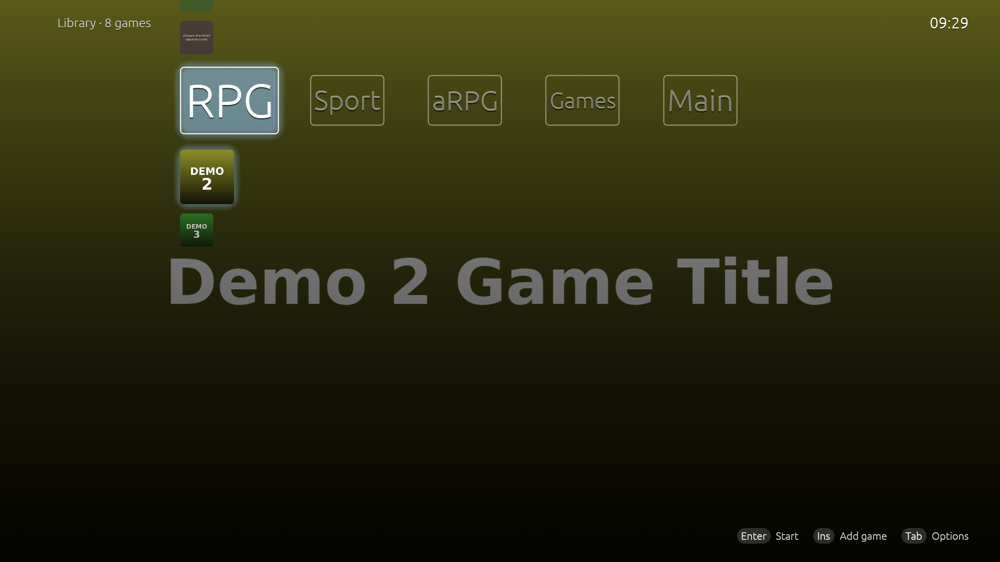

# Double axis theme


[](LICENSE)


A theme for [YASAFF](../YASAFF/), and the example of making one. The categories run along the top. The games of the selected category are listed below it.



YASAFF installs this theme in every new profile: the package from here is copied to `YASAFF/initial_content/custom_themes/`.

## Install it

1. `./package.sh` writes `dist/double_axis_theme.zip`.
2. In YASAFF, open **Settings → Theme → Import theme…** and pick the `.zip`.

The theme is added as a new theme and selected. Importing it twice gives two copies.

## What a theme package is

A `.zip` with `themeSettings.json` at its root (or inside one folder), and an optional `images/` folder next to it:

```
double_axis_theme.zip
├── themeSettings.json
└── images/             # backgrounds, bar images, icons, sounds, category images
```

A theme is a look, not code. Its `kind` picks one of the layouts built into YASAFF, and the rest of `themeSettings.json` sets that layout up. **Settings → Theme → Export theme…** writes the same `.zip` from any theme, so the easiest way to make one is to set it up in YASAFF, export it, and keep the parts you changed.

| `kind` | Layout |
|--------|--------|
| left out | Standard: a row or grid of tiles, with every tile style |
| `"bubbles"` | Games float as bubbles |
| `"double-axis"` | Categories along the top, their games below |

Every setting is optional. A missing one takes YASAFF's default, so `themeSettings.json` only needs what differs. This theme's:

```json
{
  "name": "Double axis",
  "kind": "double-axis",
  "double_axis": { "width": 220.0, "height": 120.0, "glow_color": "#8fc8ff", "glow_intensity": 0.6, ... },
  "background": { "game_art": true, "kind": "gradient", "gradient_from": "#1a1a2e", "gradient_to": "#000000" },
  "swap": { "sound": true }
}
```

Colors are `#rrggbb` or `#rrggbbaa`.

### `double_axis`

| Key | Default | Meaning |
|-----|---------|---------|
| `width`, `height` | `220`, `120` | A category's box at 1080p (80–600 and 40–400) |
| `border` | `false` | An outline around each category's box |
| `font_size` | `28` | The largest size of a category's name (10–80) |
| `dynamic_font` | `false` | Each name takes the biggest size that fits its box instead |
| `font` | none | An imported font file name; the font itself isn't part of the package |
| `text_color` | `#ffffff` | Category and game names |
| `glow_color`, `glow_intensity` | `#8fc8ff`, `0.6` | The glow around the selected category and game (0–1) |
| `title_info` | `"selected"` | Next to images, names show for the `"selected"` game, `"always"` or `"never"` |
| `images` | none | A picture for a category instead of its name: `{ "<key>": "<file in images/>" }` |

Category image keys: `category:<name>` for a category of that name (it fits any profile that has a category named the same), `builtin:uncategorized` for **Games**, and `builtin:main` for **Main** (Settings, Discover, Add game). For example:

```json
"double_axis": {
  "images": { "builtin:main": "main.png", "category:Racing": "racing.png" }
}
```

### Other files in `images/`

Every file a theme uses is named by a plain file name in `images/`: `background.image` (with `background.kind: "image"`), `top_bar.image` and `bottom_bar.image`, `swap.sound_file` (with `swap.custom_sound: true`), the special tile icons in `icons` (keys `discover`, `add` and `settings`), and button `icon`s in `buttons`. Names with `/`, `\` or `:` are ignored.

## Change it

Edit `theme/themeSettings.json`, add pictures to `theme/images/`, then:

```sh
./package.sh            # dist/double_axis_theme.zip
./package.sh --bundle   # the same, and copies it to ../YASAFF/initial_content/custom_themes/
```

The zip has fixed timestamps, so it changes only when the theme does. After `--bundle`, build YASAFF to embed the new package. Profiles that already have the theme keep their copy.
